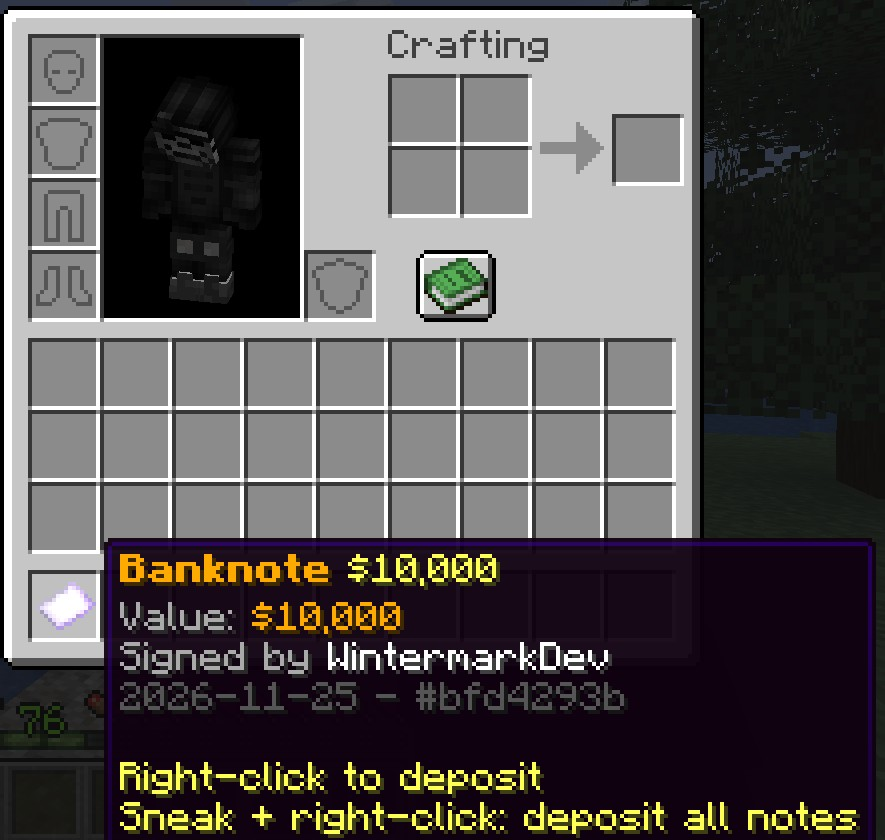
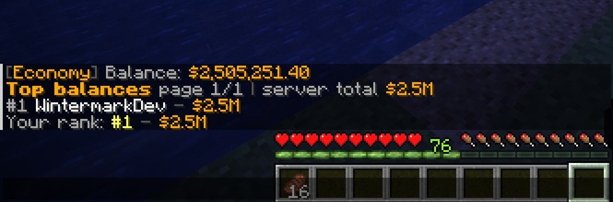
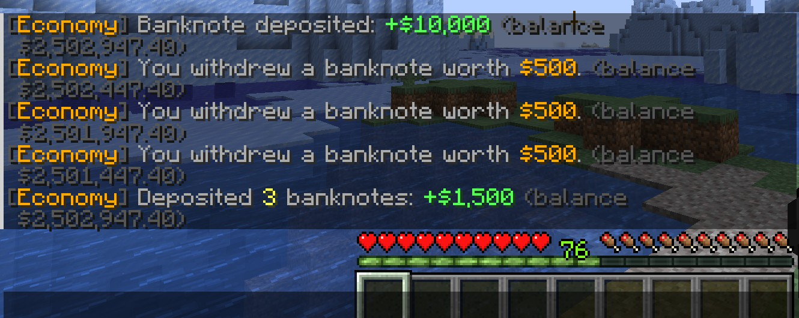
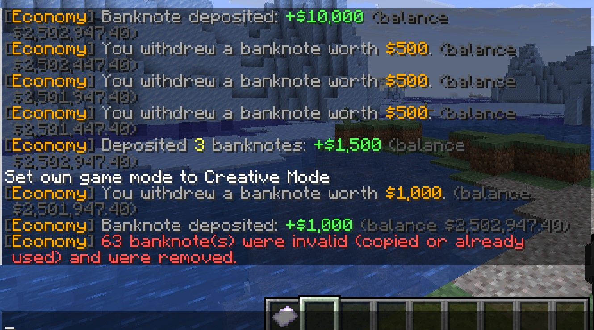
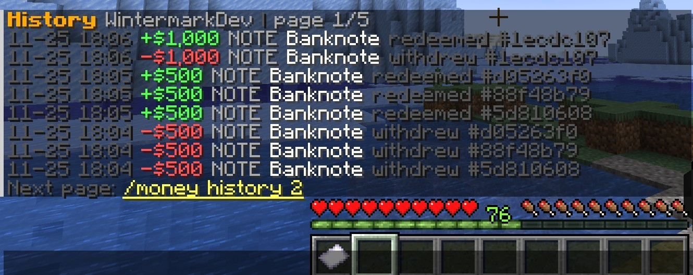

# Wintermark Economy

**A standalone economy plugin for Paper servers: balances, payments, baltop, anti-dupe banknotes and a full transaction history.**
No Vault or EssentialsX needed. Works with Vault when it is installed, so shop, rank and crate plugins from other developers can use the same money.



## Features

- **The basics, done right.** `/balance`, `/pay`, `/baltop` (cached, with pages, your own rank and the server total) and `/eco` admin tools that work from the console and on offline players.
- **Short amounts.** Type `5k`, `2.5m`, `1b` or `1t` anywhere an amount is asked. Chat and menus show short values (`$1.2M`), the history shows exact ones.
- **Banknotes.** `/withdraw 10k` turns money into a glowing, signed paper note you can trade, drop or store in a chest. Right-click to cash it, sneak + right-click to cash every note in your inventory.
- **Anti-dupe notes.** Every note has a unique id in the database and can be cashed once. Duplicated copies (creative middle-click, dupe glitches) are worthless and get removed, and the console logs a warning.
- **Transaction history.** Every payment, admin change, banknote and plugin transaction is logged. `/money history` for players, `/eco history <player>` for staff.
- **Pay safety.** Click-to-confirm above an amount you choose, `/paytoggle` to block incoming payments, a short cooldown, a minimum amount, no paying yourself, optional payments to offline players.
- **Safe storage.** SQLite database, all balances cached in memory, writes on a background thread. Money is stored as whole cents, so there are no rounding errors.
- **Vault support (optional).** With Vault or VaultUnlocked installed, Wintermark Economy registers as the server's economy.
- **Java API** for other plugins, used by Wintermark Bounties and Wintermark Auctions.
- **Fully configurable.** Currency name, symbol, format, decimals (0-4), starting balance, maximum balance, every message (MiniMessage colors). New settings are added to your config automatically on updates.

| Balance and baltop | Cashing banknotes |
|---|---|
|  |  |

| Duplicated notes are worthless | Transaction history |
|---|---|
|  |  |

## The Wintermark Economy Suite

Three plugins built to work together, each one usable on its own:

| Plugin | What it does |
|---|---|
| **Wintermark Economy** | The money: balances, payments, banknotes, history |
| [Wintermark Bounties](https://github.com/wintermarkinteractive/WintermarkBounties) | Put money on other players' heads, claim it with a kill |
| [Wintermark Auctions](https://github.com/wintermarkinteractive/WintermarkAuctions) | Auction house with categories, search and a collection box |

Bounties and Auctions use Wintermark Economy directly (their payments show up in the history as BOUNTY and AUCTION). Without it they use any Vault economy.
Plugins that pay out with a console command, like [AFK Zones](https://github.com/wintermarkinteractive/WintermarkAFKZones), [Crates](https://github.com/wintermarkinteractive/WintermarkCrates) and [Daily Rewards](https://github.com/wintermarkinteractive/WintermarkDaily), can give money with `eco give <player> <amount>`.

## Requirements

- **Paper 26.3** (or a Paper fork such as Purpur) with **Java 25**
- Optional: [VaultUnlocked](https://modrinth.com/plugin/vaultunlocked) (or Vault) to share the money with other plugins
- Not tested on Folia or Spigot

## Installation

1. Download `WintermarkEconomy-1.0.0.jar` and put it in your server's `plugins` folder.
2. Start the server. `plugins/WintermarkEconomy/config.yml` and `economy.db` are created.
3. Set your currency in `config.yml` (name, symbol, decimals, starting balance), then `/eco reload`.

If another economy plugin (EssentialsX economy, CMI...) is also installed, turn its economy off so only one plugin owns the money.

## Commands

| Command | Description | Permission |
|---|---|---|
| `/balance [player]` | Your balance or another player's (aliases `/bal`, `/money`) | `wintermark.eco.use` / `.others` |
| `/money history [page]` | Your own transaction history | `wintermark.eco.use` |
| `/pay <player> <amount>` | Send money; big payments ask for a click on [CONFIRM] | `wintermark.eco.use` |
| `/paytoggle` | Block or allow payments from other players | `wintermark.eco.paytoggle` |
| `/withdraw <amount>` | Turn money into a banknote (alias `/banknote`) | `wintermark.eco.withdraw` |
| `/baltop [page]` | Richest players (aliases `/balancetop`, `/moneytop`) | `wintermark.eco.baltop` |
| `/eco give <player\|*> <amount>` | Add money (`*` = everyone online) | `wintermark.eco.admin` |
| `/eco take <player> <amount>` | Remove money | `wintermark.eco.admin` |
| `/eco set <player> <amount>` | Set a balance | `wintermark.eco.admin` |
| `/eco reset <player>` | Back to the starting balance | `wintermark.eco.admin` |
| `/eco history <player> [page]` | Someone's transaction history | `wintermark.eco.admin` |
| `/eco reload` | Reload `config.yml` | `wintermark.eco.admin` |

`/eco` also works as `/economy` and `/weco`. All `/eco` commands work from the console.

**Permissions**

| Permission | Default | Description |
|---|---|---|
| `wintermark.eco.use` | everyone | Balance, pay, own history |
| `wintermark.eco.others` | everyone | See other players' balances |
| `wintermark.eco.baltop` | everyone | Use `/baltop` |
| `wintermark.eco.withdraw` | everyone | Make banknotes |
| `wintermark.eco.paytoggle` | everyone | Use `/paytoggle` |
| `wintermark.eco.bypass.cooldown` | op | No waiting time between payments |
| `wintermark.eco.admin` | op | All `/eco` commands; can pay players who use `/paytoggle` |

## Configuration

The default config is commented line by line. The main sections:

```yaml
currency:
  singular: "Dollar"
  plural: "Dollars"
  symbol: "$"
  format: "{symbol}{amount}"   # or "{amount} {name}" -> 1,250 Dollars
  decimals: 2                  # 0 = whole numbers; changing it converts all balances on the next start
starting-balance: "100"
max-balance: "100t"

pay:
  min-amount: "1"
  allow-offline: true
  confirm-above: "10k"         # "0" = never ask
  cooldown-seconds: 3

banknotes:
  enabled: true
  min-amount: "10"
  max-amount: "0"              # "0" = no maximum
  material: PAPER
  glow: true

history:
  keep-days: 90                # 0 = keep forever

vault:
  enabled: true                # register as Vault's economy when Vault/VaultUnlocked is installed

baltop:
  refresh-seconds: 300

messages:                      # every message, MiniMessage format
```

Text uses [MiniMessage](https://docs.advntr.dev/minimessage/format.html). Set any message to `""` to turn it off.

## For developers

```java
RegisteredServiceProvider<EconomyAPI> rsp =
        Bukkit.getServicesManager().getRegistration(EconomyAPI.class);
EconomyAPI eco = rsp == null ? null : rsp.getProvider();

EconomyResult result = eco.withdraw(player.getUniqueId(), new BigDecimal("250"), "SHOP: bought 16 diamonds");
if (result.success()) {
    player.sendMessage("Paid " + eco.format(result.amount()));
}
```

All methods are thread-safe. `deposit`, `withdraw` and `transfer` return an `EconomyResult` (status, amount, new balance) and are logged in the history with your reason. Add `softdepend: [WintermarkEconomy]` to your `plugin.yml` and the jar as `compileOnly`.

## FAQ

**Can players dupe money with banknotes?**
No. The value of a note is read from the database, not from the item, and each note id can be cashed once. Copies are removed when someone tries to cash them.

**Why does /baltop not change right away?**
The list is rebuilt in the background every 5 minutes (`baltop.refresh-seconds`) so big servers don't lag. `/balance` is always exact.

**Can I switch from cents to whole numbers later?**
Yes. Change `currency.decimals` and restart. Balances, history and open banknotes are converted.

**Where is data stored?**
`plugins/WintermarkEconomy/economy.db` (SQLite). Back it up like any world file.

## Building from source

```
git clone https://github.com/wintermarkinteractive/WintermarkEconomy.git
cd WintermarkEconomy
./gradlew build
```

The jar is in `build/libs/`. Requires JDK 25. Put the VaultUnlocked jar in `libs/` first (see `libs/README.md`); it is only used to compile the optional Vault hook.

## License

[MIT](LICENSE)

---

**Wintermark Interactive** - game mods, plugins and systems.
Designed, tested and maintained by Wintermark Interactive.
Custom plugins and server setups: wintermarkinteractive@gmail.com
